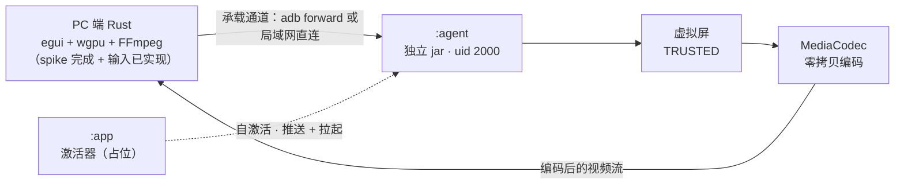

# 代码地图

> 用它在仓库里**快速定位代码**：模块 → 文件 → 职责。
> 由 [`AGENTS.md`](../AGENTS.md) 索引；分析、定位、改动代码前先看这里。

---

## 1. 维护约定（硬性）

- **新增 / 删除 / 重命名 / 移动**任何源码文件、脚本或模块后，**必须在同一次改动内**更新本文件。
- 路径一律相对仓库根，使用正斜杠。
- 「状态」列取值：`已实现` / `占位` / `未实现` / `已删除`。
- 评审改动时把本表的同步情况列为检查项（见 [`docs/spec/workflow.md §5`](spec/workflow.md)）。
- 本文件只做**导航**：不复制设计细节，细节指向对应代码与文档。

### 快速扫描命令

生成物与缓存目录不纳入地图；列真实文件用：

```bash
find . -type f \
  -not -path "./.git/*" -not -path "./.gradle/*" -not -path "./.idea/*" \
  -not -path "./.kotlin/*" -not -path "*/build/*" -not -path "*/target/*" \
  -not -name "gradle-wrapper.jar" | sort
```

---

## 2. 模块总览



| 模块 | 形态 | 运行身份 | 职责 | 状态 |
|---|---|---|---|---|
| `:agent` | 独立 jar（由 APK 改名） | shell（uid 2000），`app_process` | 建虚拟屏、零拷贝编码、传输、输入注入、拉起 App | **S1 + S2 + S4 已实现**：运行时 + 可观测性 + 连接层 + **建屏 / 编码 / 帧路径** + **输入注入**（见 [`plans/2026-10-07-agent-slicing.md`](plans/2026-10-07-agent-slicing.md)） |
| `:app` | 可安装 APK | 普通 App uid | 自激活 / 无线配置 / 推送 + 拉起 / 看门狗 | 占位（无源码、无组件） |
| | PC 端 | Rust 应用（egui + wgpu + FFmpeg），**跨平台 Win / macOS / Linux** | 电脑侧进程 | **多路合流**：接收多路视频、渲染窗口、采集鼠标键盘并发回控制 | **spike 完成 + 输入（F5 PC 侧）已实现**（8 条验收打过，见 [`plans/2026-10-07-pc-spike-report.md`](plans/2026-10-07-pc-spike-report.md)） |

---

## 3. 构建与配置文件（当前已存在）

| 路径 | 类型 | 说明 |
|---|---|---|
| `settings.gradle.kts` | Gradle | 仓库名 WCReen；`include(":app")` / `include(":agent")` |
| `build.gradle.kts` | Gradle | 根构建脚本 |
| `gradle/libs.versions.toml`、`gradle.properties` | Gradle | 版本目录（当前仅 `agp = 9.3.3`）；JVM / 构建属性 |
| `gradle/wrapper/gradle-wrapper.properties`、`gradlew`、`gradlew.bat` | Gradle | 构建入口 |
| `local.properties` | 本地 | `sdk.dir` 等本机配置，**不入库** |
| `.gitattributes` | Git | 行尾策略：源码 / 脚本 / 文档一律 LF，`*.bat`/`*.cmd` 用 CRLF |

### `:agent`

| 路径 | 类型 | 说明 | 状态 |
|---|---|---|---|
| `agent/build.gradle.kts` | Gradle | `com.android.application`；minSdk 34 / targetSdk 37 / Java 21；**唯一依赖 Gson**；`multiDexEnabled = false`；release 开 R8 | 已实现 |
| `agent/src/main/AndroidManifest.xml` | Manifest | 内容仅 `<manifest />`，声明不生效 | 已实现 |
| `agent/src/main/keepRules/rules.keep` | R8 | `-dontobfuscate` + `SourceFile,LineNumberTable` + 入口 `main` 与协议 DTO 的 keep | 已实现 |
| `agent/src/main/kotlin/com/xiaowine/wcreen/agent/` | 源码根 | 包结构与规范文档一一对应，见 [`agent/code.md §2.1`](spec/agent/code.md) | 已实现 |
| `agent/src/test/kotlin/` | 单测根 | 纯逻辑单测（协议编解码 / CLI 解析 / 握手 / 输入队列 / 指针跟踪），**不进产物** | 已实现 |
| `agent/scripts/run-agent.sh` | 脚本 | 设备端脱离 adb 启动（`nohup setsid app_process … &`） | 已实现 |

### `:app`

| 路径 | 类型 | 说明 | 状态 |
|---|---|---|---|
| `app/build.gradle.kts` | Gradle | minSdk 34 / targetSdk 37 / Java 21（与 `:agent` 一致）；零依赖 | 已实现 |
| `app/src/main/AndroidManifest.xml` | Manifest | 仅 `<application>`，无组件（无 launcher Activity） | 已实现 |
| `app/src/main/kotlin/com/xiaowine/wcreen/` | 源码根 | 待填充（当前仅 `.gitkeep`） | 占位 |
| `app/src/main/res/values/{strings,themes}.xml` | 资源 | `app_name`、`Theme.WCReen` | 已实现 |
| `app/src/main/res/{mipmap-anydpi,drawable}/` | 资源 | 启动图标（自适应图标） | 已实现 |

---

## 4. 源码位置（`:agent` S1 已实现；`app/` 为规划；`pc/` spike **已完成**）

`:agent` 的包结构与规范文档一一对应（[`agent/code.md §2.1`](spec/agent/code.md)）；
下表按包列出文件，包内每个类的职责写在它自己的 KDoc 里。`app/` 部分仍是**规划**，
实施前必须按 [`docs/spec/workflow.md`](spec/workflow.md) 讨论并写入 `docs/plans/`。

### `:agent`（`agent/src/main/kotlin/com/xiaowine/wcreen/agent/`）

| 文件 | 职责 |
|---|---|
| `Main.kt` | 入口：六步启动编排 + 主线程骨架 + 收尾（`runtime-startup.md §1`） |
| `runtime/` — `Ln` `Options` `Failure` `Signal` `Shutdown` `Coordinator` `Route` `RouteDeps` `AcceptLoop` `ReaderLoop` `LinkLoop` `SenderLoop` `InputLoop` `Teardown` | 线程骨架、队列、收尾序列、失败通道、CLI 解析、日志、**显示链路状态机**（**F6 + F7**）、**输入注入线程**（**F5**） |
| `display/` — `Bootstrap` `FakeContext` `CompanionAssociation` `DisplayFlags` `Screen` | 进程引导链（Looper + 系统 Context + 包名与 attribution 伪装）、**CDM 关联自检**（虚拟设备的硬前置）、虚拟屏 flag 组合与回读校验、建/拆/冻结（**F1**） |
| `encode/` — `CodecCaps` `EncoderParams` `VideoEncoder` | 编码能力探测与能力表、参数解析与成对校验、零拷贝硬件编码器（**F3**） |
| `input/` — `InputCmd` `InputQueue` `PointerTracker` `EventBuilder` | 触摸 / 按键指令模型、队列合并与去抖、指针状态跟踪、系统事件构造（**F5**） |
| `proto/` — `Wire` `Control` `Caps` `Screen` `Codec` `ErrorCode` `FramePayload` `Timing` `Input` | 帧框架、控制消息 / 能力表 / 申请屏幕 / 输入指令 DTO、帧负载、CRC32 + JSON 编解码、错误码、时间常量（**F4 格式**） |
| `transport/` — `Transport` `AdbTransport` `TcpTransport` `Handshake` | 传输接缝 + 两种通道 + 版本校验（**F4**） |
| `wrappers/` — `MainLooper` `SystemContext` `DisplayManagerFactory` `VirtualDisplayFlags` `InputInjector` `ActivitySizeRestrictions` `VirtualDevice` | **唯一允许反射的包**：主 Looper、`ActivityThread` 引导（+ attribution 字段伪装）、`DisplayManager` 隐藏构造器、虚拟屏 flag 常量（SDK 只暴露 5 个，其余被剥掉）、输入注入（反射 3 个成员）、**忽略活动尺寸限制**（Android 16+，可降级 ⇒ 取消兼容窗口 / letterbox）、**虚拟设备域**（建设备 + 挂屏，见 [`agent/code-hiddenapi.md`](spec/agent/code-hiddenapi.md) §3 第 7 处） |
| `agent/src/test/kotlin/` | 纯逻辑单测：协议编解码 / 帧负载 / flag 组合（`display/DisplayFlagsTest`）/ CLI 解析 / 握手 / 输入队列合并（`input/InputQueueTest`）/ 指针跟踪（`input/PointerTrackerTest`） |
| `agent/scripts/run-agent.sh` | 设备端脱离 adb 启动脚本 |

### PC 端（Rust，spike **已完成**：8 条验收逐项打过；**+ 输入（F5 PC 侧）已实现**）

工程布局为 `pc/`（Cargo workspace）。现有文件：`pc/Cargo.toml` ·
`pc/proto/{src/{dto,control,error,timing,wire,lib}.rs, tests/protocol.rs}`（线协议：帧框架 + 控制消息 + DTO）·
`pc/decode/{src/{decoder,hw,render,lib}.rs}`（FFmpeg 硬解 + 帧通路，unsafe / FFI 隔离层）·
`pc/app/{build.rs, src/{main,cli,conn,negotiate,session,ui,input,forward}.rs}`（egui + wgpu 应用与编排；`input.rs` = **输入上报 F5**、`forward.rs` = **adb 转发自愈 / 诊断**）·
`pc/spike/`（历史证据：[方案](plans/2026-10-06-pc-spike.md) **已批准** · [实施记录](plans/2026-10-07-pc-spike-implementation.md) · [实测报告](plans/2026-10-07-pc-spike-report.md)）。
按职责切分的组件：

| 组件（规划） | 职责 |
|---|---|
| 会话 / 传输 | 与 agent 建立连接、收发消息；**承载通道无关**（adb forward 或局域网直连） |
| 解码 | FFmpeg 解码视频流，**仅硬解**（不做软解回退）；**动态链接共享库随包分发**（见 [`tech-stack/pc.md`](spec/tech-stack/pc.md) §2、§4） |
| 渲染 | egui + wgpu 窗口；解码帧以 **wgpu 纹理**直接进 UI（多路 = 多张纹理，GPU 合成） |
| 输入采集（**已实现**，**F5 PC 侧**） | 鼠标 / 键盘事件 → `input` 指令：`pc/app/src/input.rs`（定频采样 + `egui` 键位 → Android keyCode 映射）+ `pc/app/src/ui.rs`（采集） |

---

## 5. 按问题找代码

| 我要找…… | 目标文件 | 状态 |
|---|---|---|
| 进程启动顺序与致命顺序依赖 | `Main.kt` + `display/Bootstrap.kt` | 已实现（S1） |
| 线程怎么划分、谁是唯一写者 | `runtime/AcceptLoop.kt` / `ReaderLoop.kt` / `SenderLoop.kt` / `Route.kt` | 已实现（S1） |
| 收尾为什么按这个顺序拆 | `runtime/Teardown.kt` | 已实现（S1） |
| 失败分几级、谁负责善后 | `runtime/Failure.kt` | 已实现（S1） |
| 握手与包头怎么定义的 | `transport/Handshake.kt` + `proto/Wire.kt` + `proto/Codec.kt` | 已实现（S1） |
| 判活（心跳 / 超时）在哪 | `proto/Timing.kt` + `runtime/ReaderLoop.kt` + `runtime/Coordinator.kt` | 已实现（S1） |
| 反射 / 隐藏 API 的版本差异 | `wrappers/`（`MainLooper` / `SystemContext` / `DisplayManagerFactory` / `VirtualDisplayFlags` / `InputInjector` / `ActivitySizeRestrictions`） | 已实现 **6 处**（S1、S2、S4 + 2026-10-07） |
| 虚拟屏 flag 怎么组合、某个 bit 什么意思 | `display/DisplayFlags.kt` + `wrappers/VirtualDisplayFlags.kt` | 已实现（S2） |
| `app_process` 下怎么造出可用 `Context` | `display/Bootstrap.kt` + `wrappers/SystemContext.kt` | 已实现（S2） |
| 编码器怎么配、尺寸能力怎么探 | `encode/CodecCaps.kt` + `encode/EncoderParams.kt` + `encode/VideoEncoder.kt` | 已实现（S2） |
| 帧怎么从编码器走到 socket（背压 / 丢帧） | `runtime/LinkLoop.kt` + `runtime/SenderLoop.kt` | 已实现（S2） |
| 怎么在虚拟屏上起 App | `launch/`（F2） | 未实现 |
| 触摸 / 按键消息怎么变成系统事件 | `input/`（F5） | 已实现（S4） |
| 鼠标 / 键盘怎么变成 `input` 指令 | `pc/app/src/input.rs` + `pc/app/src/ui.rs` | 已实现（**F5 PC 侧**） |
| **连不上设备 / USB 掉线后连不上** | `pc/app/src/forward.rs` + `pc/app/src/session.rs`（重连循环） | 已实现（**adb 转发自愈**） |
| 设备日志在哪、怎么排查 | `adb logcat -s WCReen`（**无日志文件**，见 `docs/spec/agent/module.md §6`） | — |

---

## 6. 文档索引

本仓库全部文档（不回链外部仓库）：

| 文档 | 内容 |
|---|---|
| [`AGENTS.md`](../AGENTS.md) | 协作规范索引（先读这个） |
| [`docs/spec/workflow.md`](spec/workflow.md) | 讨论 → 方案 → 实施 工作流；方案文档格式 |
| [`docs/spec/git.md`](spec/git.md) | git 操作规则 |
| [`docs/spec/comments.md`](spec/comments.md) | 中文注释规范 |
| [`docs/spec/agent/module.md`](spec/agent/module.md) + [`code`](spec/agent/code.md) + [`hiddenapi`](spec/agent/code-hiddenapi.md) | `:agent` 总览：子系统地图、8 条不变量、构建与部署、禁忌；**代码形态**（包结构 / 命名 / 失败形态 / 并发原语 / DTO / 装配 / 可测性分层）；**隐藏 API 访问形态**（尽可能不用反射 / 运行期 6 处清单 / 四条纪律） |
| [`docs/spec/agent/display.md`](spec/agent/display.md) | `:agent` 显示源（F1）：范围、参数模型与变更、Context 引导、验收 |
| [`docs/spec/agent/display-flags.md`](spec/agent/display-flags.md) | `:agent` 虚拟屏 flags（F1）：分档清单、`DESTROY_CONTENT_ON_REMOVAL` 对照实验、常量真实数值 |
| [`docs/spec/agent/display-letterbox.md`](spec/agent/display-letterbox.md) | `:agent` 虚拟屏上的**裁切（letterbox）机制**与"铺满"可选做法**留档**（F1）：三条触发条件、分屏/配置两支比例、双端实测矩阵、取证方法 |
| [`docs/spec/agent/display-changelog.md`](spec/agent/display-changelog.md) | F1 **变更记录**(从 `display.md` 提成独立文件) |
| [`docs/spec/agent/display-lifecycle.md`](spec/agent/display-lifecycle.md) | `:agent` 显示源生命周期:建立 / 断开与重连 / 冻结 A-B / 结束与异常 |
| [`docs/spec/agent/encode.md`](spec/agent/encode.md) | F3 **入口**：范围、文档地图 + [变更记录](spec/agent/encode-changelog.md) |
| [`encode-probe`](spec/agent/encode-probe.md) · [`params`](spec/agent/encode-params.md) · [`format`](spec/agent/encode-format.md) · [`lifecycle`](spec/agent/encode-lifecycle.md) · [`capability`](spec/agent/encode-capability.md) · [`pitfalls`](spec/agent/encode-pitfalls.md) | F3 细则：能力探测与并发协商 · 编码参数与**显式设置总表** · 格式组与色彩元数据 · 生命周期与静止态可解码性 · 能力**实测快照**（换设备即作废） · 边界发现与重测指引 |
| [`docs/spec/agent/launch.md`](spec/agent/launch.md) + [`input`](spec/agent/input.md) | `:agent` **输入与拉起**（F2 + F5）：指令模型、判据与失败分类、输入注入与队列合并 |
| [`docs/spec/agent/launch-verified.md`](spec/agent/launch-verified.md) | F2 **实机验证结果**:V1-V6 + 附带发现 |
| [`docs/spec/agent/module-changelog.md`](spec/agent/module-changelog.md) | `:agent` 模块规范**变更记录**(从 `module.md` 提成独立文件) |
| [`docs/spec/agent/launch-enumerate.md`](spec/agent/launch-enumerate.md) | `:agent` 枚举可启动应用（F2）：参数、实现路径、字段、缓存与名单口径 |
| [`docs/spec/agent/features.md`](spec/agent/features.md) | `:agent` 功能清单：F1–F7 状态、依赖、后置与不做（单一事实来源；F8 已撤销） |
| [`docs/spec/agent/features-changelog.md`](spec/agent/features-changelog.md) + [`features-changelog-archive`](spec/agent/features-changelog-archive.md) | `:agent` 功能清单**变更记录** + **归档**（2026-10-06 及更早） |
| [`docs/spec/agent/runtime.md`](spec/agent/runtime.md) + [`runtime-startup`](spec/agent/runtime-startup.md) + [`runtime-threads`](spec/agent/runtime-threads.md) + [`runtime-lifecycle`](spec/agent/runtime-lifecycle.md) + [`runtime-failure`](spec/agent/runtime-failure.md) + [`runtime-observability`](spec/agent/runtime-observability.md) + [`runtime-changelog`](spec/agent/runtime-changelog.md) | `:agent` 运行时（F6 / F7）：启动与通信解耦（传输无关）、**启动编排**、`main()` 骨架、**线程模型**、**生命周期状态与协调**、**失败与退出**、**心跳与日志** |
| [`docs/spec/agent/transport.md`](spec/agent/transport.md) + [`transport-topology`](spec/agent/transport-topology.md) + [`transport-handshake`](spec/agent/transport-handshake.md) + [`transport-protocol`](spec/agent/transport-protocol.md) + [`transport-messages`](spec/agent/transport-messages.md) + [`transport-shapes`](spec/agent/transport-shapes.md) + [`transport-backpressure`](spec/agent/transport-backpressure.md) | `:agent` 传输与协议（F4）：入口 + **拓扑与多路结构** + **握手与能力协商** + **协议格式** + **消息清单** + **报文形状（确切 JSON + 错误码表）** + **背压与丢帧**；`transport-messages.md` 的变更记录已提成 [`transport-changelog`](spec/agent/transport-changelog.md) |
| [`docs/spec/agent/transport-changelog.md`](spec/agent/transport-changelog.md) | F4 **变更记录**(从 `transport-messages.md` 提成独立文件) |
| [`docs/spec/app/module.md`](spec/app/module.md) | `:app` 模块约束 |
| [`docs/spec/tech-stack/overview.md`](spec/tech-stack/overview.md) | 技术栈总览：三侧语言/框架、构建链、依赖与测试政策、未决项、变更记录 |
| [`docs/spec/tech-stack/pc.md`](spec/tech-stack/pc.md) + [`pc-frame-path`](spec/tech-stack/pc-frame-path.md) | PC 端：跨平台后端、容量（**不做容量处理**）、输入上报（**F5 PC 侧，已实现**）、连接与 adb 转发（**自愈，已实现**）；**多路合流 / 硬解 / 帧通路**（三环节分工、T0–T2 成本阶梯、静默软解实测、硬解强校验、延迟量化）见 `pc-frame-path.md`（从 `pc.md` §2 提成） |
| [`docs/spec/tech-stack/pc-ffmpeg.md`](spec/tech-stack/pc-ffmpeg.md) | PC 端 **FFmpeg 接入**：动态链接 + 随包分发、被否路径 |
| [`docs/spec/tech-stack/pc-ui.md`](spec/tech-stack/pc-ui.md) | PC 端：UI 层选型、否决 GPUI 的依据、被否方案 |
| [`docs/spec/tech-stack/changelog.md`](spec/tech-stack/changelog.md) + [`changelog-archive`](spec/tech-stack/changelog-archive.md) | 技术栈**变更记录**（从 `overview.md` 提成独立文件）+ **归档**（2026-10-06 追加系列） |
| [`docs/spec/docs.md`](spec/docs.md) | 文档规范：分模块、单文件上限（200 行 / 12 KB）、拆分与登记 |
| [`docs/prototype.md`](prototype.md) | 原型位置唯一入口 + 使用界限 |
| [`docs/plans/`](plans) | 实现方案文档（长期保留） |

> 本仓库是重构：设计依据、协议文本、坑与对策一律写进**本仓库**；
> 需要提原型时只链接 [`docs/prototype.md`](prototype.md)（见 [`AGENTS.md`](../AGENTS.md) 红线 4）。

---

## 7. 生成物与忽略目录

分析代码时**忽略**以下内容，它们不是源码：

| 路径 | 内容 |
|---|---|
| `build/`、`agent/build/`、`app/build/` | Gradle 构建产物（含 `outputs/apk/*`、`intermediates/`） |
| `target/` | Cargo 构建产物（PC 端） |
| `.gradle/`、`.kotlin/` | Gradle / Kotlin 缓存 |
| `.idea/`、`local.properties` | IDE 配置；本机 SDK 路径（`sdk.dir`，不入库） |

构建产物路径（**已实现**）：

- `agent/build/outputs/apk/release/agent-release-unsigned.apk` → 改名 `.jar` 推到设备；
- `app/build/outputs/apk/{debug,release}/…apk`。
